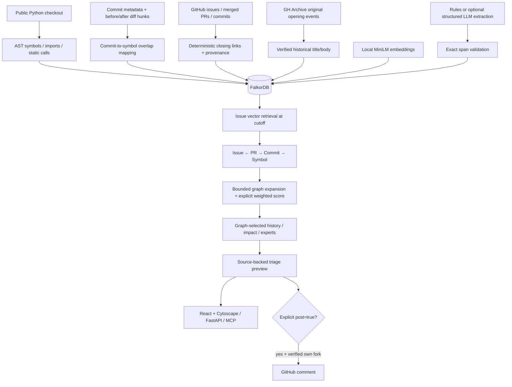

# WhyGraph architecture

## Persistence boundary

FalkorDB is the only agent context store. Each tool retrieves graph facts directly through readable parameterized Cypher or a defined graph scoring algorithm. The Git checkout and HTTP caches are ingestion transport artifacts. Evaluation JSON/CSV and original opening snapshots are reproducibility/audit artifacts; runtime context retrieval never consults them.

Symbols use stable `repo:file_path:qualified_name` IDs. A before/after hunk mapper records modifications against either revision, handling removed functions. Rename metadata is preserved on `MODIFIED`; same-qualified-name current functions can inherit historical evidence only when a real prior Git file move proves continuity. The original modified symbol and relocation source remain visible in the path.

## Temporal model

- Issues: creation time plus text availability; verified opening snapshots give original title/body. Otherwise a current description is eligible only after its `updated_at`.
- PR fix knowledge: only after both PR creation and merge, with closing and PR-commit edge timestamps checked.
- Commits and diff edges: immutable Git timestamps, excluded if later than the cutoff.
- Source structure: code is parsed from the latest reachable default-branch Git revision before the cutoff. `CALLS`, `CONTAINS` and `IMPORTS` carry that ref. Per-snapshot symbol metadata resides on `CONTAINS`; future source text is never used for historical expansion.
- Claims: source availability determines `valid_from`; extraction time determines `created_at`. Both must precede a historical query. Supersession ends the old half-open validity interval and retains historical evidence.

The current small-corpus vector procedure requests all indexed issues, then filters by availability before taking top K. This avoids future vectors crowding a historical ANN shortlist. The runtime's raw cosine score is a distance; an identical-vector integration test verifies the conversion and sort order.

## Workflow, routing and uncertainty

The deterministic orchestrator retrieves historical issues, projects their completed fixes to code, expands local structural neighbors, and scores candidates. It runs history/impact/experts only for the top three graph-selected symbols. Candidate score components and original supporting paths are returned as data. A missing path produces an explicit lack of evidence rather than an invented function or rationale.

The optional LLM only proposes rationale spans. It receives untrusted source text and returns a strict schema. Pydantic validates its fields; the source-span guard verifies literal occurrence. No model supplies Cypher, chooses GitHub action parameters, or invents graph relationships.

The preview is a structured recommendation plus Markdown. Numbered-issue previews read fresh GitHub text and persist a `TriagePreview` in the same FalkorDB graph with a random ID, repository/fork/issue scope, original issue JSON, exact response JSON, and a 30-minute expiry. Free-text previews remain read-only and create no posting ID. Posting loads this record and returns its saved findings and Markdown without re-running analysis. Expired records are rejected and pruned on subsequent preview creation. These action snapshots are not semantic retrieval candidates. Posting requires an explicit action flag, a matching, unexpired preview ID, a configured fork verified against the original repository, a valid token belonging to that fork's owner, an unchanged issue, and no matching prior recommendation marker. No background agent action posts comments.

## Evaluation and known compromises

The harness separates retrieval from future gold-label reads. It compares BM25 issue retrieval, semantic issue retrieval with direct fix projection, and full graph expansion/ranking. Each case reconstructs a historical source snapshot. It includes cold starts, reports all five requested metrics, and retains predictions and actual symbols for audit.

The measured graph/vector tie is reported without tuning on the test cases. The next useful experiment is a broader historical fix corpus and a held-out set, followed by an ablation of structural expansion. Multi-repository support, automatic fixes/PR generation, implicit-rationale inference and automatic contradiction detection are deliberately absent.

## Interface and regression checks

Each input edit or workflow change aborts the pending preview request and advances a request version. Success, error, and completion callbacks update state only for that version. A new query clears old findings before fetching; a failed post retains the reviewed preview. Form inputs and workflow tabs are disabled during an explicit post so the UI can show its outcome. Aborting a preview cannot authorize a post.

History groups rows by commit SHA and preserves distinct symbol/PR/issue paths underneath that commit. Twenty distinct commits are shown initially; Show more adds another twenty. Counts state both raw graph records and distinct commits. Impact empty states explain the approximate static analysis.

Playwright exercises the actual React UI and Cytoscape renderer with deterministic API fixtures. Network gates reproduce input edits and tab switches while requests are pending. Python tests separately verify the HTTP posting flow, fresh issue validation and the saved Markdown, and a live FalkorDB test verifies preview persistence through another database client.
