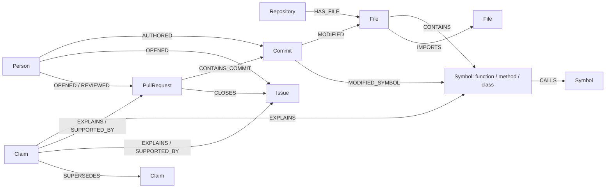

# WhyGraph

**A repository memory that remembers why code changed.**

Developers can read what a function does, but its constraints, workarounds and design reasons often live in old issues and PR discussions. WhyGraph connects Python code structure to that history, retrieves evidence through FalkorDB, and uses the resulting paths to decide which functions to inspect and who to suggest as reviewers.

This MVP indexes **one public Python repository: `pallets/click`**. It supports function history, semantic issue retrieval, graph-based localization, reverse-call impact, expertise ranking, source-backed triage previews, and explicit posting to your own verified fork.

## Start here

- [Install and run](#run): fresh-clone setup, database choices, ingestion, and servers.
- [Test the app](#teammate-test-checklist): a short acceptance checklist and useful bug reports.
- [Troubleshooting](#troubleshooting): connection, model, API, and platform issues.
- [Architecture](ARCHITECTURE.md), [FalkorDB resource review](docs/FALKORDB_REVIEW.md), [evaluation analysis](evaluation/analysis.md), and [teammate message](docs/TEAMMATE_TEST_MESSAGE.md).

## Run

Requirements: Python 3.12+, Node.js 22.12+ or a current supported Node release, Git, and uv. Use Docker for the standard FalkorDB runtime; FalkorDBLite is available for local development without Docker. Allow network access for package installation, the Click clone, public GitHub API calls, and the first embedding-model download. No LLM key is needed for the default demo.

### 1. Clone and install

```bash
git clone https://github.com/Abhigyan-Shekhar/Graph-Hacks-Brain.git
cd Graph-Hacks-Brain
cp .env.example .env
```

Choose **one** database option below. Run backend commands from this repository root. Keep `.env` local; it is ignored by Git.

**Option A — Docker:** leave `FALKORDB_MODE=server` in `.env`.

```bash
uv sync --locked --extra dev --extra semantic --extra mcp
docker compose up -d
uv run python -m scripts.check_connection
```

**Option B — FalkorDBLite:** edit `.env` and set `FALKORDB_MODE=lite`, then run:

```bash
uv sync --locked --extra dev --extra semantic --extra mcp --extra lite
uv run python -m scripts.check_connection
```

FalkorDBLite runs the actual FalkorDB module and persists to `.data/falkordb.db`. There is no mock persistence fallback. Initial development validation used FalkorDBLite. Follow-up validation on macOS with Python 3.12 used Docker and passed all 46 Python tests, the MCP handshake/history query, and the production build. The 14 Chromium browser regressions run with API fixtures and do not require the database. The Compose image follows `latest`; pin its digest for a stable deployment.

### 2. Configure and ingest the demo

A fresh clone does **not** contain `.env`, the database, the Click checkout, API caches, or downloaded models. The checked-in evaluation files are measured artifacts; seeing them in the UI does not mean your graph is populated.

Keep `TARGET_REPO=pallets/click`. For the same source revision as the measured demo, set `TARGET_REF=06b2a678741131fd577ce170e23e5ca0aeba0309` in `.env`; leaving `HEAD` indexes the latest fetched default-branch revision. Set `GITHUB_TOKEN` to your own valid token if public API rate limits interrupt ingestion. Leave `TRIAGE_FORK`, `LLM_API_KEY`, and `LLM_MODEL` blank for a preview-only demo.

Run these commands in order. Git history ingestion and the first embedding-model download are the slow steps; this is a one-time setup per local graph.

```bash
uv run python -m scripts.ingest_repo --stage code
uv run python -m scripts.ingest_repo --stage git
uv run python -m scripts.ingest_repo --stage github --prs 28
uv run python -m scripts.verify_links
uv run python -m scripts.archive_issue_text
uv run python -m scripts.embed_graph
uv run python -m scripts.extract_claims
```

The checked-in original issue snapshots let the Click demo reuse verified opening-event text without downloading the archive again. Evaluation is optional: run `uv run python -m evaluation.run --repo pallets/click` after ingestion to regenerate the measured files; it can take longer and modifies `evaluation/results.json` and `evaluation/results.csv`.

`verify_links` refuses the gate unless five distinct issue → PR → commit → symbol paths match real Git patches. The audit artifact is `evaluation/link-verification.json`. Public GitHub ingestion caches transport responses and observes rate-limit errors. Set `GITHUB_TOKEN` for repeated fresh ingestion or comment/review enrichment. Use `--comments` to ingest issue comments, PR discussion comments and reviews; it requires more API requests. Raw caches are ignored and are never the agent's context store.

The selected initial corpus contains the first 28 merged PRs returned by the deterministic closing-keyword search, all reachable default-branch history, and fetched PR refs for commits removed from mainline ancestry by squash/rebase. PR-to-PR closing references and non-Python changes are explicitly distinguished from issue fixes. This is a bounded corpus, not a claim that every GitHub discussion has been ingested.

For a different Python repository, use a fresh `FALKORDB_GRAPH`, set `TARGET_REPO`, and use a matching checkout at `.data/repo`. The MVP rejects mixing repositories in one graph. The checked-in evaluation snapshots and results belong only to Click.

### 3. Start the interface

In one terminal:

```bash
uv run python -m uvicorn backend.main:app --host 127.0.0.1 --port 8000
```

In another:

```bash
cd frontend
npm ci
npm run dev
```

Open [WhyGraph](http://127.0.0.1:5173). Check [backend health](http://127.0.0.1:8000/api/health) for `{"ok":true,"store":"FalkorDB"}` and [repository status](http://127.0.0.1:8000/api/status) for nonzero symbol, commit, PR, and issue counts. Interactive API docs are at [FastAPI docs](http://127.0.0.1:8000/docs).

Keep both terminals running. Press Ctrl+C in each to stop the app; Docker users can then run `docker compose stop` from the root. The graph persists locally, so subsequent runs only need the database and the two servers. Changes to `.env` require restarting the backend and any MCP process.

The React UI shows repository status, function history, triage, directed graph evidence, source URLs, agent trace, and measured evaluation results. Vite proxies `/api` to FastAPI. Both development servers bind to loopback.

## Three-minute demo

1. In **Function history**, query `click._termui_impl.ProgressBar.generator`. Show the actual rationale extracted from PR #706 and its issue #651 → PR → commit → symbol evidence. Git file relocation is a separate identity-continuity step, not a fabricated commit edge to a future location.
2. Open **Evaluation**. Report the measured values below and the vector/graph tie.
3. In **Issue triage**, preview “Progress bar does not update after each item is processed.” Follow the graph-selected functions, ranking components, reverse callers, verified rationale and reviewer evidence.
4. For the external action, configure a valid token and your fork, create an issue there, preview its number, then explicitly press **Post triage comment to my fork**. No GitHub comment was posted during development.

The same tools are available from the CLI:

```bash
uv run python -m scripts.query history --symbol click._termui_impl.ProgressBar.generator
uv run python -m scripts.query impact --symbol click.core.Command.main
uv run python -m scripts.query experts --symbol click.termui.prompt
uv run python -m scripts.query similar_issues --title 'Progress bar advances too early'
uv run python -m scripts.query localize --title 'Progress bar advances too early'
uv run python -m scripts.query triage --title 'Progress bar advances too early' --body 'The work happens inside the loop.'
```

### Explicit GitHub action

Set `TRIAGE_FORK=your-login/click` and a valid `GITHUB_TOKEN`. Posting checks GitHub's fork/parent metadata and the authenticated owner. Upstream posting is disabled. Numbered-issue previews fetch fresh issue text and store the exact response and Markdown in FalkorDB for 30 minutes. Posting requires the returned `preview_id`, verifies the fork/issue/cutoff, checks fresh issue text against the saved preview, and checks for a duplicate recommendation marker. It never regenerates the reviewed comment. Expired previews are rejected and cleaned up when a new numbered preview is saved.

```bash
uv run python -m scripts.query triage --issue 1
# Review the Markdown; copy the Preview ID printed to stderr.
# This separate command explicitly authorizes posting that exact preview:
uv run python -m scripts.query triage --issue 1 --post --preview-id YOUR_PREVIEW_ID
```

The MCP equivalent is `triage(issue_number=1, post=false)` for preview, then `triage(issue_number=1, post=true, preview_id="RETURNED_ID")` for action. HTTP `/api/query` uses the same `issue_number`, `post`, and `preview_id` fields with `tool="triage"`. Free-text previews cannot be posted. A new backend/MCP process can load a saved preview from the same graph; changed or expired previews require another explicit review. Labels and reviewer requests are outside this MVP. Live posting was not exercised because no valid GitHub token or owned fork was provided; preview and action guards are tested.

## Teammate test checklist

Run this after fresh-clone setup, with posting credentials left blank:

1. **Connection:** the UI reports a connected FalkorDB store and populated repository counts.
2. **History:** query `click._termui_impl.ProgressBar.generator`. Check that the timeline includes real GitHub sources and the PR #706 / issue #651 rationale. Open a source link to inspect the evidence.
3. **Triage:** preview “Progress bar does not update after each item is processed.” Check recommended functions, score components, graph paths, sources, and trace. Posting should be disabled without a configured fork/token.
4. **Input changes:** edit the issue text after a preview and while a preview is loading. The previous recommendation should clear and stay cleared; switch tabs during loading as well. Request a new preview and confirm its inputs match. History groups multiple records from the same commit into expandable evidence paths and offers **Show more history** when there are more than 20 distinct commits.
5. **Evaluation:** confirm the table shows keyword Top-1 20%, vector 30%, and WhyGraph 30%. These are saved results from the measured Click corpus, not a new run against your database.
6. **Automated checks:** run the unit tests, live database tests, MCP handshake, and production build below.

Report your OS, Python/Node versions, Docker or Lite mode, the failing command or UI steps, expected/actual behavior, and relevant terminal output. Include a screenshot for UI problems. Remove tokens and other credentials from logs. Use a GitHub issue in this repository for reproducible bugs.

## Troubleshooting

| Symptom | What to check |
|---|---|
| Connection refused / API health fails | For server mode, check `docker compose ps` and `docker compose logs falkordb`; wait for startup, then rerun `scripts.check_connection`. For Lite, install `--extra lite` and set `FALKORDB_MODE=lite`. |
| Lite package cannot install or start on your platform | Use the Docker option; Lite depends on a compatible native runtime. |
| UI is blank or API calls fail | Keep FastAPI running on port 8000. Start Vite from `frontend/`; verify `/api/health` directly. Check both terminal logs. If a port is occupied, stop the old process before restarting. |
| Empty history / no recommendations | A clone starts with no graph. Complete code, Git, GitHub, snapshot, embedding, and claim stages against the same `.env` and graph name; inspect `/api/status`. |
| GitHub 403 / rate-limit error | Add a valid `GITHUB_TOKEN` to `.env`, wait for the rate limit if necessary, and rerun the failed ingestion stage. An invalid token can also fail public requests. |
| Embedding download fails | Check internet access to the configured model host and retry `scripts.embed_graph`. The first run downloads MiniLM; later runs use its local cache. |
| Node / Vite engine error | Use Node 22.12+ and rerun `npm ci` in `frontend/`. |
| Posting is disabled or rejected | Free-text triage is a preview. Posting needs an existing issue in your authenticated account's verified Click fork, `TRIAGE_FORK`, a valid token with issue-write permission, and explicit action. Refresh the preview if the issue changed. |

## Why FalkorDB

FalkorDB stores code, historical facts, provenance, rationale, temporal metadata and embeddings. Semantic issue retrieval starts inside its vector index. Localization then follows:

```text
historical Issue ← CLOSES — PR → CONTAINS_COMMIT → Commit
                                               → MODIFIED_SYMBOL → Symbol
                                                                   → CALLS / callers
Person → AUTHORED → Commit                         Claim → evidence
```

The graph selects candidate functions and thus determines which history, impact and expert tools the agent runs. Removing FalkorDB breaks retrieval, historical reconstruction, ranking, blast radius, expertise and triage. Neither a relational database nor an external vector database is used.

## Graph schema



See `backend/graph/schema.py` for the explicit properties and `cypher/schema.cypher` for indexes. Symbol IDs are `repo:file_path:qualified_name`. Historical GitHub edges retain `source_url`, `source_type`, `timestamp`, and `confidence`. Structural edges are tagged with their Git `snapshot_ref`. Each `CONTAINS` edge preserves symbol metadata for that revision, so a later docstring or line range cannot leak into a historical query.

## Actual Cypher

These queries are loaded directly from `cypher/` by the backend.

### History

```cypher
MATCH (s:Symbol)<-[:MODIFIED_SYMBOL]-(c:Commit)
WHERE s.id IN $symbols AND c.timestamp <= $as_of
OPTIONAL MATCH (p:PullRequest)-[:CONTAINS_COMMIT]->(c)
WHERE p.created_at <= $as_of AND p.merged_at <= $as_of
OPTIONAL MATCH (p)-[:CLOSES]->(i:Issue)
WHERE i.created_at <= $as_of
RETURN c,p,i,s ORDER BY c.timestamp DESC
```

### Localization

```cypher
MATCH (i:Issue)<-[cl:CLOSES]-(p:PullRequest)
  -[pc:CONTAINS_COMMIT]->(c:Commit)-[m:MODIFIED_SYMBOL]->(s:Symbol)
WHERE i.id IN $issues AND i.created_at < $as_of
  AND p.created_at <= $as_of AND p.merged_at <= $as_of
  AND c.timestamp <= $as_of AND cl.timestamp <= $as_of
  AND pc.timestamp <= $as_of AND m.timestamp <= $as_of
RETURN i.id,p,c,s
```

Candidates expand one hop through `CALLS`, reverse `CALLS`, and up to 20 same-file symbols, all restricted to the cutoff's source snapshot. Components remain visible:

```text
score = .40 * semantic similarity
      + .25 * normalized distinct historical fix count
      + .20 * graph proximity (direct 1.0, call neighbor .65, same file .30)
      + .10 * recency (1 / (1 + days / 365))
      + .05 * call graph support
```

Expanded neighbors do not inherit a direct fix count. Scores are ranking signals, not calibrated probabilities. There is no global PageRank or static dense `SIMILAR_TO` graph.

### Impact

```cypher
MATCH path=(caller:Symbol)-[:CALLS*1..3]->(target:Symbol {id:$symbol})
WHERE all(e IN relationships(path) WHERE e.snapshot_ref=$snapshot)
RETURN caller, [s IN nodes(path) | s.qualified_name] AS path
LIMIT 100
```

### Experts

```cypher
MATCH (person:Person)-[:AUTHORED]->(c:Commit)-[:MODIFIED_SYMBOL]->(s:Symbol)
WHERE s.id IN $symbols AND c.timestamp <= $as_of AND person.login <> ''
RETURN person.login,count(DISTINCT c) AS changes,max(c.timestamp) AS latest
```

Additional graph queries count prior fixes and related reviews. The score is `2*direct_changes + fix_count + .75*review_count + recency`; source URLs accompany every person recommendation.

## Rationale and temporal validity

The default extractor selects a small number of explicit rationale spans. `Candidate` structured validation rejects absent spans and paraphrases presented as direct quotes. Claims record source author/time/span and connect to their supporting issue or PR. A direct symbol `EXPLAINS` edge requires an explicit symbol name in the source, not merely membership in the same PR.

For optional model extraction, configure `LLM_API_KEY`, `LLM_MODEL`, and optionally `LLM_BASE_URL`, then run:

```bash
uv run python -m scripts.extract_claims --llm
```

This uses the Responses API with a strict JSON schema; all suggestions undergo the same exact-span validation. No API call was made during development because no model key was supplied. Refusals/incomplete responses are explicit errors. Graph traversal, ranking and external actions never depend on a model inventing links.

Claims use the half-open interval `valid_from <= as_of < valid_to`, or an open end. Extraction `created_at` is not backdated. `backend.graph.temporal.supersede` supports explicit same-subject supersession and atomically ends the older claim. Automatic contradiction detection is deferred. `scripts.demo_seed` is an optional, clearly synthetic temporal example in a separate graph; it is not ingested into the real repository or used by evaluation.

## Evaluation: real measured results

Twenty closed issues with merged symbol-changing fixes were evaluated at their creation timestamps. The input is **original title/body recovered from the issue's opening event in GH Archive**, matched by stable GitHub issue ID and timestamp. `evaluation/issue-snapshots.json` includes event IDs and archive URLs. Pre-2015 archives lack original text; those cases are excluded for data availability, not accuracy. Cold-start cases remain in the denominator.

Retrieval excludes future issues and text edits, PRs not yet merged, future commits, future historical path edges and future-created claims. Structural expansion uses actual Git code before each issue cutoff. Ground-truth functions are read only after predictions and are never supplied to the ranking system. The checked-in artifacts are `evaluation/results.json` and `evaluation/results.csv`.

| Approach | Top-1 | Top-3 | Top-5 | MRR | Recall@5 |
|---|---:|---:|---:|---:|---:|
| Keyword / BM25 | 20% | 25% | 30% | .2375 | 11.65% |
| Vector only / MiniLM | 30% | 30% | 30% | .3000 | 12.00% |
| WhyGraph | 30% | 30% | 30% | .3000 | 12.00% |

**The graph did not outperform vector-only retrieval in this sample.** Both found six issues at rank one. Graph expansion adds explainable context and routing but has not demonstrated an accuracy gain. See `evaluation/analysis.md` for observed failures and limitations. No weights were tuned on these twenty cases.

Reproduce with `uv run python -m evaluation.run --repo pallets/click`. The model revision used was `1110a243fdf4706b3f48f1d95db1a4f5529b4d41`; set `EMBEDDING_REVISION` from `.env.example`. `uv.lock` and the frontend lockfile pin package versions.

## MCP and tests

The stdio server exports exactly `history`, `localize`, `impact`, `experts`, `similar_issues`, and `triage`:

```bash
# Start the MCP server only when configuring a client (it waits on stdin):
uv run python -m backend.mcp_server
```

Run these checks separately from the repository root, after ingestion:

```bash
uv run python -m scripts.check_mcp
uv run python -m pytest -q
WHYGRAPH_INTEGRATION=1 uv run python -m pytest -q
(cd frontend && npm run build)
```

The default pytest run skips live database tests; `WHYGRAPH_INTEGRATION=1` enables them against isolated temporary graph names. The validated full suite has 46 passing Python tests, including six live database tests. The default run passes 40 tests and skips those six. Chromium browser tests add 14 regressions. `scripts.check_mcp` performs a real stdio handshake, checks the six tool names, and calls history; it needs the populated demo graph.

For an MCP client, use the absolute Python executable in this checkout's `.venv`, arguments `-m backend.mcp_server`, and this repository as the working directory. A direct executable avoids writing package-manager status to stdio. Graph/API structured logs go to stderr and include elapsed time, result counts, paths and ranking components. `DEBUG_QUERIES=true` exposes Cypher without parameter values or credentials.

Browser checks run a temporary Vite server on port 4173 and intercept API/GitHub responses; they do not start the backend, ingest data, or post GitHub comments:

```bash
cd frontend
npm ci
npx playwright install chromium --only-shell
npm run test:e2e
```

The runner stops Vite afterward. Failure screenshots and traces are saved in ignored `frontend/test-results/`. Browser regressions cover edits during pending requests, both tab-switch directions, backend errors and retries, grouped/paginated history, source links, graph zoom/pan/reset/node taps, preview IDs, and stale-issue errors. Date validation, exact comment posting, expiry/scope checks, duplicate suppression, fresh issue fetches, and persistence through a new database client have Python coverage. External posting transport is mocked; no credentialed posting was performed.

Critical tests cover functions, async methods, imports, statically resolved calls, shadowed names, nested scopes, diff overlap and deletion, closing keywords, invalid rationale spans, temporal boundaries, synthetic graph ranking, future path exclusion, future vector crowding, action guards and MCP tool schemas.

## Limitations

- Python only, one repository, bounded GitHub history selection.
- AST analysis is approximate; dynamic dispatch, unresolved receivers and many runtime aliases are skipped. Nested definitions with the same qualified name share a logical identity.
- Symbol IDs include paths. Same-qualified-name continuity across a file move requires a real Git rename edge. Arbitrary renames and multi-step rename chains are imperfect.
- Git hunks mark enclosing classes and functions; evaluation deliberately scores functions/methods only. Merge commits are diffed against their first parent. Parent/child commits can both appear in timelines.
- Rationale extraction misses implicit reasoning. Direct claims are source-backed statements, not proof that every rationale applies to every changed symbol. No derived rationale claims are generated by default.
- Comments/reviews are opt-in and were not fetched for this bounded initial corpus. Expert history improves when author identities and reviews are available.
- Twenty evaluation cases and 28 fix PRs are too few for a broad accuracy claim; several cases have no earlier fix evidence. Functions introduced by the eventual fix may not yet exist to localize.
- GH Archive opening snapshots omit later comments that were already available before a cutoff. Vector queries currently request the whole small issue corpus before filtering to avoid future-neighbor crowding; this must change for a larger corpus.
- Local development API, not a multi-user production service. Live GitHub posting and optional model extraction need valid credentials and were not exercised. Docker was validated during follow-up testing; FalkorDBLite remains the alternative local runtime.

## Verified API references

- [FalkorDB Python client](https://github.com/FalkorDB/falkordb-py)
- [FalkorDB vector indexes](https://docs.falkordb.com/cypher/indexing/vector-index)
- [FalkorDB vector query implementation](https://github.com/FalkorDB/FalkorDB/blob/master/src/procedures/proc_vector_query.c): this tested runtime yields cosine **distance**, so search sorts ascending and converts `1-distance` to similarity. The live identical-vector test guards that behavior.
- [FalkorDBLite](https://github.com/FalkorDB/falkordblite)
- [FalkorDB Docker setup](https://docs.falkordb.com/operations/docker)
- [GitHub pull-request REST API](https://docs.github.com/en/rest/pulls/pulls)
- [GH Archive](https://www.gharchive.org/)
- [Structured output documentation](https://developers.openai.com/api/docs/guides/structured-outputs)

See `ARCHITECTURE.md` for workflow and temporal design.
